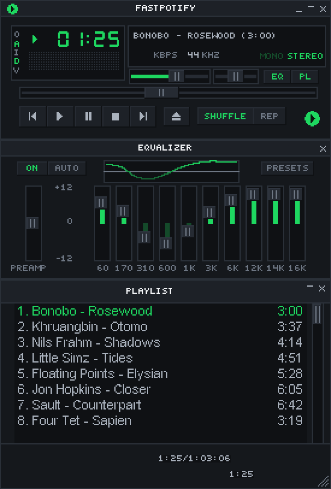

# The Winamp Mini Player

Open the mini player with Ctrl+M (Cmd+Shift+M on macOS), the shrink button, or
**Switch to it** in Settings. It supports classic Winamp 2 `.wsz` skins and
Windows Media Player `.wmz` skins. Find Winamp skins at the
[Winamp Skin Museum](https://skins.webamp.org).

Only one player window is open at a time. Click the skin logo or Eject, use
the shortcut again, or choose **Open main window** from the tray menu to return
to the main window. On Hyprland, skinned windows ask the compositor for no
border, rounding, shadow or blur, so a round skin is not drawn inside a
rectangle.

## Skins and window size

Drop a `.wsz` file on either window to install and use it. The **Mini player**
section in Settings shows Winamp skins and Windows Media Player skins under
their own titles, each installed skin as a card with a picture of it. Click a
card to wear that skin. The first time you scroll to them, the pictures are
drawn in the background, one skin at a time, and kept for next time. A skin
that cannot be drawn shows its name instead. It can still be worn. A `.zip`
file is listed under the kind of skin it holds. **Open folder** opens the one
folder both kinds are kept in.

Unpacked skins can keep their files inside nested folders, up to eight levels
below the skin's own folder, as Windows' Extract All leaves them. File names
are matched without regard to case. If a name appears more than once, the copy
closest to the skin's folder wins; ties use folder and file name order.
Symbolic links are skipped.

Turn on **Random skin** in Settings to pick a different installed skin, of
either kind, each time the mini player opens. The built-in skin is part of the
selection. Choosing a specific skin turns Random off.

The mini player uses whole-number scaling to keep pixels sharp. Right-click
the title bar, or click **O**, to choose 1x to 4x and set always-on-top. **D**
steps through the sizes, 1x to 4x, and **A** toggles always-on-top. Fastsonic
remembers the window position.

On Windows and in Linux X11 sessions, turn off **Show in taskbar** under
**Settings > Mini player**, or in the **O** menu, to drop the mini player's
taskbar button. The choice
survives restarts. The mini player stays visible; the tray icon, Ctrl+M, the
skin logo, and launching Fastsonic again still reach the app, and returning to
the main window always brings its taskbar button back. Changing the option
while the mini player is open replaces that window while playback continues.
On X11 it hides the mini player from panels and task switchers that follow
the window manager's skip-taskbar state. Wayland has no standard way for an
app to leave the taskbar, so the option is not offered there; use your
desktop's window rules instead. It does not change the macOS Dock.

**Always on top** works on Windows, macOS and X11. On Wayland the app's
controls are unavailable, because the window backend cannot apply them; use
your desktop's window rule or shortcut instead. In KDE Plasma, configure
**Keep Window Above Others** under **Settings > Keyboard > Shortcuts > Window
Management**. Your saved preference returns when you use Fastsonic on a
supported backend again.

Non-rectangular skins use `region.txt` for transparent areas. Winamp 3 and 5
skins use a different format and are not supported.

MilkDrop, opened from a classic skin's mini player, is a panel of the player,
under the equalizer and the playlist. It wears the skin's generic window frame
from `gen.bmp`; a skin without one borrows the built-in skin's. Drag its bottom
right corner to make it taller, and the window grows with it. It stays as wide
as the player. It moves with the
player, and the skin's double size applies to it.

The button beside its close button, a double click on the picture, or **F**
takes MilkDrop to full screen. A Windows Media Player skin's visualisation area
does the same with a double click, or the button that shows when you point at
it. Full screen is the lyrics view, with MilkDrop behind the words in place of
the cover's art; leaving it brings the skin back as it was.

## Windows Media Player skins

The mini player also wears Windows Media Player skins. Drop a `.wmz` file on
either window, exactly as with a Winamp skin, or put an unpacked skin folder
with a `.wms` file in it into the skins folder, and pick it in Settings. The
Internet Archive's
[Windows Media Player Skins Collection](https://archive.org/details/windowsmediaplayerskinscollection)
has over 170 of them.

Fastsonic comes with two of its own, listed first under Windows Media Player
in Settings. **Fastsonic Tall** is small enough to keep at the side of your
screen: a white
ceramic ribbon round a smoked-glass core. It opens with a thread of green light
tracing its outline, and that light burns under the arch while the music plays.
Click the square, or the small button below it, to switch between the album art
and the visualizer. The dots at the top of the glass change its page, from Now
Playing to the equalizer to the queue, where a click plays a song. It remembers
what you chose. **Fastsonic Wide**, listed after it, is the same object laid on
its side, with the ribbon arching over the right of a long glass core, for the
top or bottom of a screen. It works the same way and remembers its own choices.

A skin runs as it did in Windows Media Player. Its own scripts run, in a
sandbox with no access to your files, the network or other programs, so its
intro animations, drawers, shutters and hidden panels work. Every view it
defines works: a skin that opens separate windows for its playlist, equalizer
or visualisation opens real windows here too. Windows take the skin's shape.
A skin's preferences, such as which panels were open, are kept for next time.
The picture on a skin's card comes from running it the same way, with a song
partway through and still bars in place of the visualisation.

Skins work with what Fastsonic has:

- **Playback** controls, seek, volume, mute, shuffle and repeat are real. Fast
  forward and rewind jump ten seconds, and Stop pauses and rewinds.
- **Playlist** panels show the playing song and the queue. Double-click a row
  to play it.
- **Equalizer** panels change Fastsonic's equalizer, and balance changes the
  balance. Moving a band turns the equalizer on. Skins with settings Fastsonic
  has no match for, such as SRS WOW or crossfade, show them without effect.
- **Visualisation** areas show MilkDrop, moving and scaling with the skin. A
  skin's next and previous visualisation buttons change the preset. Until the
  picture arrives, and whenever there are no presets or the graphics card
  cannot draw it, they show the same bars or sound wave as the Winamp display.
  Either way the picture comes from the sound after the equalizer and before
  the volume. Open MilkDrop once to download its presets.
- **Video** areas show the song's cover. Music has no video here, so a skin
  that waits for video to open its video view does not open it.
- **File, CD, library and web** buttons do nothing: a skin plays what Fastsonic
  plays, and it cannot open files or web pages.

Sounds a skin plays for itself are not played. A few skins use pictures or
text built into Windows Media Player; those parts stay blank. Many skins have
bugs in their own scripts that Windows Media Player ignored, and Fastsonic
ignores them as well.

A Windows Media Player skin is drawn at one pixel per screen pixel unless you
choose a size, either in Settings under **Mini player** or from the
right-click menu. Both kinds of skin share that one size. Drag anywhere that is
not a control to move the window, and press **Ctrl+M** (**Cmd+Shift+M** on
macOS) to go back to the big window. A skin's own Close and Return buttons do
the same.

## Main controls

Most controls match Winamp. As in Winamp, Play on a song that is already
playing starts it again from the beginning; Pause pauses. These work
differently:

- **Stop** pauses and rewinds.
- **I** opens the playing album in the main window.
- Repeat is either on or off.
- The X button and both logos return to the main window.

Click the time to switch between elapsed and remaining time. The balance and
MONO/STEREO controls affect playback on this computer. Quit from the
right-click menu or with Ctrl+Q.

The shade button, or a double-click on the title bar, rolls the player up. Its
tiny spectrum analyser or oscilloscope keeps moving in the collapsed bar;
click the display to cycle through bars, waveform and off, just like the full
player. The playlist and equalizer have their own shade buttons.

Switching to the main window and back keeps the shade modes and restores the
mini player's own position. It does not inherit the main window's fullscreen
or maximized state. A saved position on a display that is no longer
connected is not kept: the player opens on one that is.
Wayland compositors choose window positions themselves and may ignore the
saved position.

The left display shows the spectrum analyser. Click it to switch to the
oscilloscope, then off. You can also use the **V** menu. The visualiser uses
local audio after the equalizer and before volume, so it still moves at zero
volume.

## Playlist

**PL** opens the playlist below the player. It shows the playing song followed
by the queue. Double-click a song to play it, Ctrl-click to select several, and
drag the lower-right corner to resize the window. Use X or **PL** to close it.

- **ADD** opens search or Liked Songs.
- **SEL** selects rows.
- **MISC** opens song, artist, and album pages.
- **LIST OPTS** starts one of your playlists or saves the queue as a new one.
- **REM → Remove selected** takes the selected songs you queued out of the
  queue, and **REM → Remove all** clears every song you queued.

Queued songs are owned by Fastsonic's audio engine. Both **REM** entries leave
the songs of the playing album or playlist in place. The queue remembered from
the last session, shown before anything plays, is not the engine's yet, so
neither entry changes it. Notices from the main window scroll through the mini
player's text display.
The skin's capital-letter font folds accented Latin letters, including Turkish
letters, to its available shapes. Other scripts use a fallback font.

## Equalizer

**EQ** opens the ten-band equalizer. It affects playback on this computer.
The preamp ranges from -12 to 0 dB. **AUTO** resets all bands. The same
controls and presets are in Settings.

To keep your own curve, such as a headphone correction, type a name under the
presets in **Settings > Equalizer** and choose **Save preset**. It stores the
preamp and the ten bands, and appears after the built-in presets in Settings
and in the mini player's **PRESETS** menu, which scrolls when the list is
longer than the window. Saving under a name you already used replaces that
preset. While a saved preset is in use, **Delete** beside **Save preset**
removes it; the sound stays as it is.
